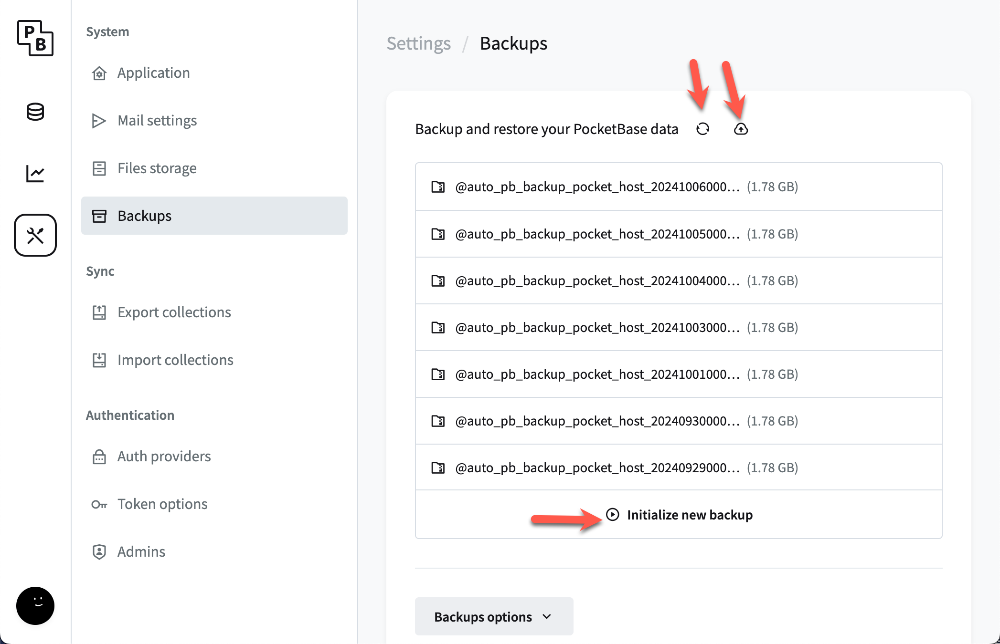

# Backups and Data Protection

PocketHost makes every effort to protect your data, but you should always keep your own backups. This page covers how to do that well on PocketHost.

## Best practices

1. **Store file uploads in your own S3 bucket, with versioning turned on.**
2. **Send PocketBase backups to your own S3 bucket, with versioning turned on.** It can be the same bucket or a different one.
3. **Schedule backups with a [webhook](/docs/webhooks)** so they run on schedule, even while your instance is hibernating.
4. **Restore a backup once** on a spare instance, so you know it works before you need it.

The rest of this page explains why, and how to set each one up.

## Why your own versioned S3 bucket

Your bucket is the one copy of your data that you fully control. It sits outside PocketHost, and you decide how long it keeps things.

**Versioning is what protects you from mistakes.** When a record is deleted or a file is replaced, PocketBase deletes the old file from storage. With versioning on, your bucket keeps the earlier version, so you can bring it back. The same goes for backups: if a backup is deleted by accident, its earlier version is still in the bucket.

**PocketBase backups don't include files stored in S3.** A backup holds your database. Your uploads are protected by your bucket's version history instead. If you restore an older backup, it can bring back records whose files were deleted since. Versioning means those files are still there to recover.

**Set a lifecycle rule** that removes old versions after a period you're comfortable with, such as 30 or 90 days, so storage doesn't grow forever.

Most S3-compatible providers support versioning and lifecycle rules. Check that yours does before you choose it. To connect a bucket, see [S3 Storage](/docs/s3). Files in your own bucket also don't count toward your [disk storage](/docs/limits#disk-storage).

## How scheduled work runs on PocketHost

PocketBase has a built-in scheduler. It runs `cronAdd` jobs and the backup schedule in **Settings > Backups**. That scheduler lives inside the PocketBase process, so it only runs while your instance is running.

On PocketHost, instances [hibernate](/docs/how-it-works) when they're idle. While an instance sleeps, its built-in scheduler sleeps too. So on PocketHost the schedule lives in the platform instead. [Webhooks](/docs/webhooks) call a route on your instance at the times you choose, and wake it up if it's asleep. Anything you would do with `cronAdd`, you can do with a webhook.

Here's why it works this way, and why everybody comes out ahead:

- **Idle instances cost nothing to keep around.** An instance that isn't handling a request isn't using memory or CPU. That's what keeps the price per instance low, and it's why every instance you pay for can run.
- **Your schedule survives anything that happens to your instance.** Restarts, version changes, deploys, and crashes don't touch it, because it isn't stored in your instance. If PocketHost itself restarts while a run is due, that run happens as soon as PocketHost is back.
- **Every job is an ordinary route.** You can run it by hand from your browser or with `curl`, test it locally, and see exactly what it returns. The same route works anywhere PocketBase runs. On your own server, any scheduler can call it.
- **You can see what happened.** The dashboard shows when each webhook last ran and what your route returned. Failures also go to your instance's [logs](/docs/logs).
- **Long jobs can finish.** Each webhook call can run for up to 30 minutes. Your instance stays awake until your route responds.

## Schedule backups with a webhook

This runs PocketBase's own backup job, so it uses your backup settings: your S3 bucket, and the **Max @auto backups** setting that removes old backups. It needs **PocketBase 0.24 or newer**. On an older version, [change versions](/docs/versions) first.

**1. Set up backups in the PocketBase admin.** Go to **Settings > Backups**.

- Turn on **automatic backups** and enter any schedule, such as `0 3 * * *`. PocketBase only creates its backup job when a schedule is set. The webhook is what runs it on time.
- Set **Max @auto backups** to how many you want to keep.
- Turn on **S3 storage** and connect your versioned bucket.

**2. Add a secret token.** Create a [secret](/docs/secrets) named `BACKUP_WEBHOOK_TOKEN` with a long random value. Power your instance off and on so it picks up the new secret.

**3. Add the route.** Save this as `pb_hooks/backup.pb.js`:

```javascript
routerAdd('GET', '/api/webhooks/backup', (e) => {
  if (e.request.url.query().get('token') !== $os.getenv('BACKUP_WEBHOOK_TOKEN')) {
    return e.json(401, { error: 'Unauthorized' })
  }

  // PocketBase's own scheduled backup job
  const job = $app.cron().jobs().find((j) => j.id() === '__pbAutoBackup__')
  if (!job) {
    return e.json(400, { error: 'Set a backup schedule in Settings > Backups first' })
  }

  job.run() // creates the backup, then removes the oldest beyond Max @auto backups
  return e.json(200, { ok: true })
})
```

**4. Add the webhook.** In your instance dashboard, open **Webhooks** and add:

- **API Endpoint**: `/api/webhooks/backup?token=YOUR_TOKEN`
- **Schedule**: `0 3 * * *` (daily at 3:00 UTC), or whatever suits you

**5. Test it.** Open `https://YOUR_INSTANCE.pockethost.io/api/webhooks/backup?token=YOUR_TOKEN` in your browser. You should see `{"ok":true}` and a new backup in **Settings > Backups**.

### Good to know

- **Writes wait while a backup runs.** PocketBase pauses database writes while it builds the backup, then they continue. Reads aren't affected. Backups are quick when your uploads live in S3, because then the backup is only the database.
- **You might occasionally see an extra backup.** If your instance happens to be awake at the schedule you set in step 1, PocketBase runs the job itself too. **Max @auto backups** removes the extra one.
- **Check on it now and then.** The dashboard shows each webhook's last run and response. Look in **Settings > Backups** from time to time to confirm new backups are arriving.

## Restore from the admin

PocketBase's backup and restore tools are in the admin under **Settings > Backups**. You can restore without powering off your instance.



## Older backups move to cold storage

This applies to backups kept on PocketHost's disk. Backups in your own S3 bucket aren't moved.

PocketHost keeps your **most recent backup** on disk. Once a day, older backups move to cold storage.

In the PocketBase Backups list, each moved backup is replaced by a text file with the same name plus `.txt`, for example `pb_backup_20261101.zip.txt`.

- **To get one back**: download the `.txt` file from the Backups list and open it. It contains a download link for the original zip.
- **To restore it**: download the zip from that link, then in the PocketBase admin go to **Settings > Backups**, upload the zip, and restore it.
- **How long**: moved backups are kept for **180 days**. After that they're deleted and the link stops working.
- **Deleting the `.txt` file deletes the backup.** When the `.txt` file is gone from your Backups list, whether you deleted it or PocketBase removed it as an old scheduled backup, the copy in cold storage is deleted 14 days later.
- **Scheduled backups**: PocketBase counts `.txt` files toward **Max @auto backups**, and removes the oldest first, the same as zips.
- **Restoring the `.txt` file itself does nothing.** It isn't a backup, so PocketBase leaves your data as it is.

## Back up and restore with the CLI

If the admin isn't available or your instance won't start, use the [PocketHost CLI](/docs/cli#files). Power off the instance, then run `pockethost pull --data pb_data` to download the database and uploads. To restore, run `pockethost upload ./pb_data`. [SFTP](/docs/ftp) works too until it is retired on February 6, 2027.
