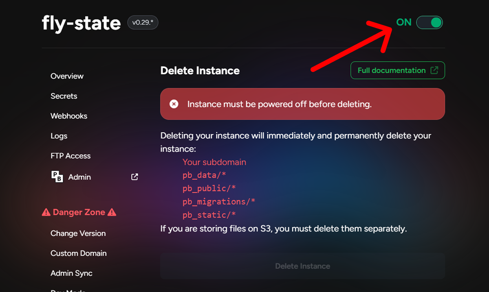
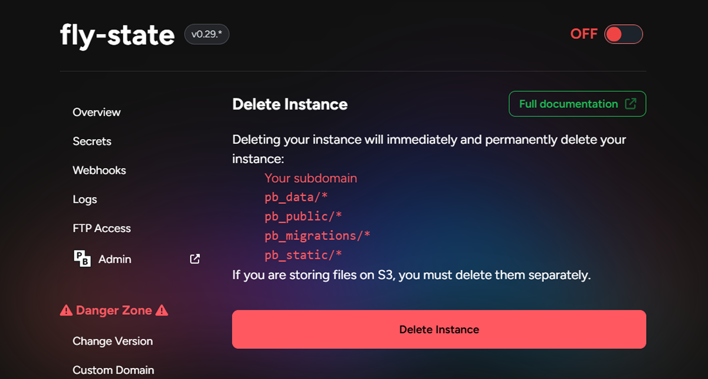

# Deleting an Instance

Deleting an instance will immediately power it down and remove it from your account.

Before you can delete an instance, it must first be [powered off](/docs/power).

Once deleted, you lose access to:

- Your subdomain
- All files in `pb_data/*`
- All files in `pb_public/*`
- All files in `pb_migrations/*`
- All files in `pb_static/*`

The instance no longer appears in the dashboard and is not reachable over SFTP or HTTP.

### After you delete

PocketHost holds the files for **30 days**, then removes them. During that window they are not served and you cannot open them from your account.

That hold exists so we can recover from a mistaken delete. It is not a backup, and we do not guarantee recovery from it.

**PocketHost does not back up your instance data.** If you might need the data later, create a backup with PocketBase's built-in backup tools before you delete. See [Backup and Restore](/docs/backup-restore).

