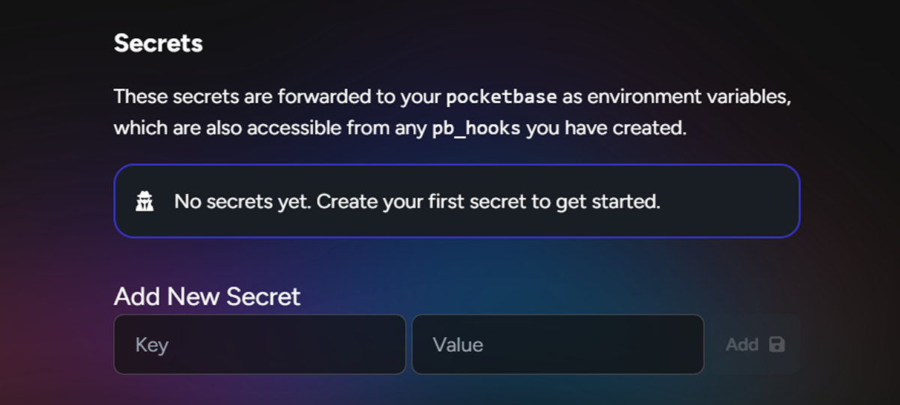

# Secrets

Secrets are created through the PocketHost instance dashboard and are automatically made available in the PocketBase runtime environment, including `pb_hooks`. Use secrets to securely store API keys and other sensitive information that should not be embedded in your source code.

## Reserved names

Some secret names also change how PocketHost runs your instance:

| Secret              | What it does                                                                 |
| ------------------- | ---------------------------------------------------------------------------- |
| `PB_ENCRYPTION_KEY` | Encrypts your PocketBase settings. See [Settings Encryption](/docs/encryption). |
| `PH_CORS_ORIGINS`   | Limits which websites can call your instance from a browser. Applies within seconds, no restart. See [CORS Origins](/docs/cors). |

PocketHost also sets a few environment variables of its own, such as `PH_INSTANCE_URL`. A secret with the same name is replaced. See [What PocketHost Adds](/docs/whats-added#environment-variables).

Other secrets take effect the next time your instance starts. To apply a change right away, power the instance off and on.
